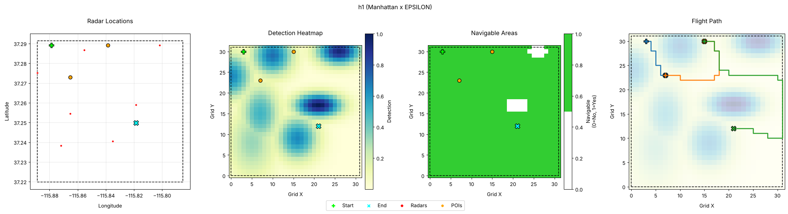

# Stealth Route Planning

A* path planning for a stealth aircraft that must visit a sequence of points of interest (POIs) while staying out of radar coverage. The map is discretised into a grid, each cell gets a detection probability from the radars around it, and A* searches for the route with the lowest total exposure, comparing three heuristics.

Developed by **José María Duro Agea** as the heuristic search assignment of *Artificial Intelligence* (BSc Computer Science and Engineering, Universidad Carlos III de Madrid, 2024-25).



## How it works

**1. Detection map.** Radars are generated at random positions (fixed seed) with random physical parameters. The maximum range of each radar comes from the radar equation, and its detection strength over the map is modelled as a 2D Gaussian. Each cell keeps the strongest detection among all radars, and the whole map is Min-Max scaled to `[EPSILON, 1]` (`EPSILON = 1e-4`) so that no move is free. This matters because zero-cost moves would break the heuristics below.

**2. Search problem.**

| Element | Definition |
|---|---|
| State | A grid cell `(i, j)` |
| Actions | Up, down, left, right (no diagonals) |
| Constraint | A cell can only be entered if its detection is `<= tolerance` |
| Cost of a move | Detection value of the destination cell |
| Goal | Visit every POI in the given order |

The grid becomes a directed `networkx` graph containing only the allowed moves, and each leg of the route (POI k to POI k+1) is solved with A*.

**3. Heuristics.** Let `d` be the Manhattan distance to the goal.

| Heuristic | Formula | Admissible |
|---|---|---|
| `h1` | `EPSILON * d` | Yes, and consistent: every move costs at least `EPSILON` |
| `h2` | `min(detection_map) * d` | Yes, and consistent (same argument) |
| `h3` | `detection(i, j) * d` if `detection(i, j) <= theta`, otherwise `min(detection_map) * d`, with `theta = min(0.5, 0.7 * tolerance)` | **No** (see below) |

`h3` is an extra heuristic I designed beyond what the assignment asked for. The idea is to estimate the remaining cost using the risk around the aircraft in low-risk areas, and to fall back to the conservative estimate in high-risk areas.

## Results

Path cost (lower is safer) and nodes generated by A* (lower is faster). All runs use seed 42. "No path" means no route stays under the tolerance.

| Scenario | Grid | Radars | POIs | Tolerance | h1 / h2 cost | h1 / h2 nodes | h3 cost | h3 nodes |
|---|---|---|---|---|---|---|---|---|
| scenario_0 | 16x16 | 1 | 2 | 0.10 | No path | 221 | No path | 221 |
| scenario_0 | 16x16 | 1 | 2 | 0.80 | 0.241 | 240 | 0.241 | 222 |
| scenario_1 | 16x16 | 3 | 2 | 0.21 | No path | 0 | No path | 0 |
| scenario_1 | 16x16 | 3 | 2 | 0.22 | 1.027 | 199 | 1.027 | 177 |
| scenario_2 | 32x32 | 7 | 4 | 0.22 | 4.392 | 910 | 4.642 | 484 |
| scenario_2 | 32x32 | 7 | 4 | 0.75 | 4.392 | 1,172 | 4.408 | 473 |
| scenario_3 | 32x32 | 10 | 4 | 0.37 | 8.365 | 1,086 | 8.687 | 639 |
| scenario_3 | 32x32 | 10 | 4 | 1.00 | 7.951 | 1,307 | 9.458 | 512 |
| scenario_7 | 128x128 | 20 | 6 | 0.25 | No path | 12,425 | No path | 11,765 |
| scenario_7 | 128x128 | 20 | 6 | 0.80 | 37.840 | 25,419 | 37.840 | 5,233 |
| scenario_8 | 256x256 | 32 | 6 | 0.80 | 131.366 | 88,697 | 137.766 | 14,866 |
| scenario_10 | 32x32 | 8 | 3 | 0.40 | 6.812 | 1,522 | 7.533 | 1,088 |
| scenario_10 | 32x32 | 8 | 3 | 0.90 | 6.812 | 1,725 | 7.533 | 1,042 |

### What the results show

- **h1 and h2 are identical by construction.** Because the detection map is always scaled to `[EPSILON, 1]`, its global minimum is exactly `EPSILON`, so `h2` reduces to `h1` on every map. Both always return the optimal path.
- **h3 trades optimality for speed.** It is not admissible: when the cells between the aircraft and the goal are cheaper than the current one, it overestimates the remaining cost. In exchange it generates far fewer nodes, about 6x fewer on scenario_8 and 5x fewer on scenario_7, while the paths it returns cost between 0% and 19% more than the optimum (worst case: scenario_3 at tolerance 1.0). This is the same trade-off that weighted A* makes on purpose.
- **Tolerance below about 0.25 often leaves no safe route,** because the POIs themselves or the corridors between them end up blocked.

### Changes after the original submission

Reviewing the project for publication, I made a few corrections:

- `theta` in `h3` was hardcoded to `0.35`, so it ignored the tolerance despite the design. It now depends on the tolerance as intended, which is why some h3 figures differ from the submitted report.
- `h2` and `h3` recomputed `np.min(detection_map)` on every heuristic call (a million cells per call on a 1024x1024 map). The minimum is now computed once when the heuristic is built (`make_h2`, `make_h3`).
- The docstrings claimed that `h3` was admissible and consistent. They now state that it is not.
- The counter reported as "nodes expanded" counts heuristic evaluations. NetworkX's A* evaluates the heuristic once per newly discovered node, so it is now reported as **nodes generated**.
- Paths are stored as `(row, col)` tuples instead of strings that were later parsed back with `eval`.
- A run with no safe path is reported as such instead of as a cost of `0.0`, and `main.py` validates its arguments and finds `scenarios.json` regardless of the working directory.

## Usage

```bash
python -m venv .venv
source .venv/bin/activate        # Windows: .venv\Scripts\activate
pip install -r requirements.txt

python main.py <scenario_name> <tolerance>
python main.py scenario_2 0.75
```

The program prints the cost and the generated nodes for each heuristic and opens one figure per heuristic: radar locations, detection heatmap, navigable cells and the final route. Scenarios are defined in `scenarios.json` (`scenario_0` to `scenario_11`). `scenario_9` (1024x1024) works but takes a long time.

## Project structure

| File | Content | Origin |
|---|---|---|
| `SearchEngine.py` | Graph construction, heuristics, A* over the POI sequence, path cost | Course skeleton (function signatures); implementation and `h3` are mine |
| `Map.py` | Radar generation and detection map | Radar generation from the course; `compute_detection_map` is mine |
| `main.py` | Command line entry point and visualisation | Argument parsing and run flow from the course; four-panel visualisation and heuristic comparison are mine |
| `Radar.py`, `Location.py`, `Boundaries.py` | Radar model and geographic helpers | Course base code, unchanged |
| `scenarios.json` | Test scenarios | `scenario_0` to `scenario_9` from the course; `scenario_10` and `scenario_11` are mine |

## Possible improvements

- Vectorise `compute_detection_map` with NumPy. It loops in pure Python over every cell and every radar, and it dominates the run time: on scenario_8 it takes about 19 s, against under 1 s for building the graph and running all the searches.
- Add diagonal moves (8-connectivity) with an adapted heuristic.
- Add unit tests for the heuristics (admissibility on small maps against Dijkstra) and for the coordinate discretisation.

## License

MIT, see [LICENSE](LICENSE). The files marked above as course base code were provided by the teaching staff of the course.